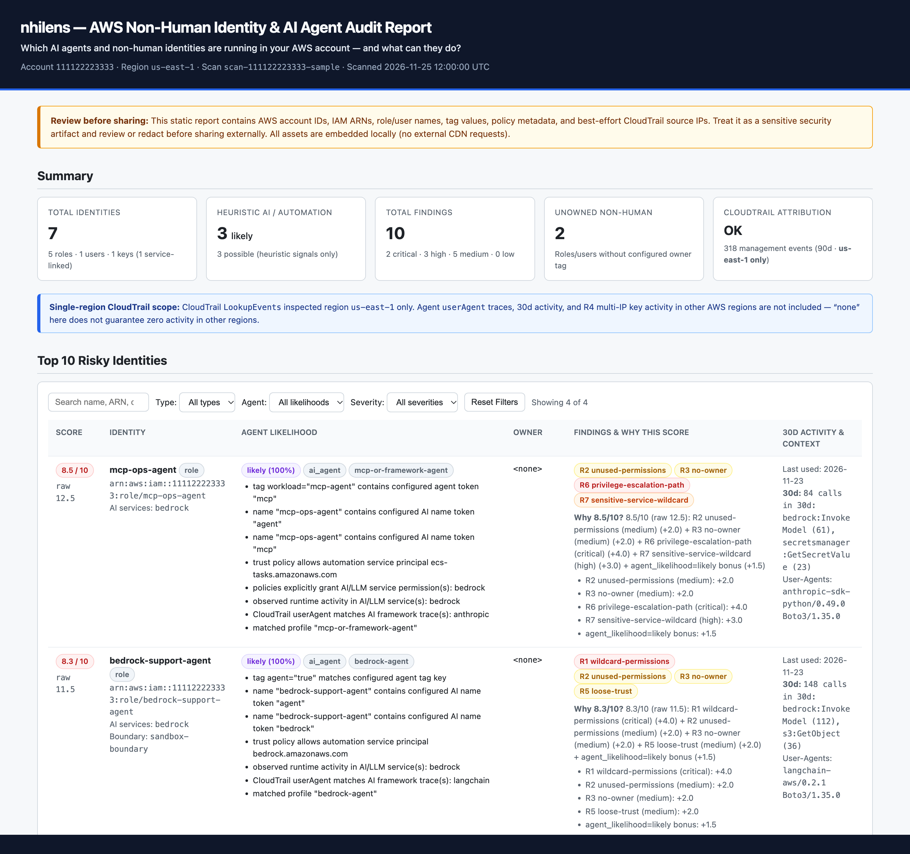
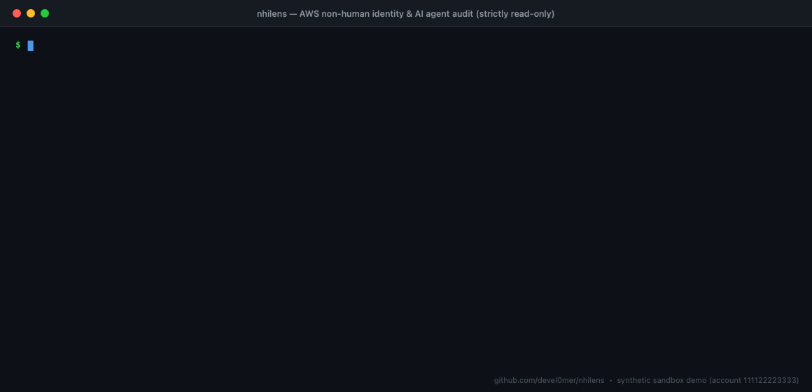

# nhilens

**Which AI agents and non-human identities are running in your AWS account — and what can they do?**

List every AI agent, bot, IAM role, and static access key in an AWS account, flag the unowned and over-privileged ones, and see exactly why they're risky — strictly read-only, single static Go binary, zero telemetry.



*(Synthetic sandbox output from `nhilens demo` — open [docs/sample-report.html](docs/sample-report.html) in any browser for the interactive offline report.)*

---

## Try in 60 Seconds (No AWS Credentials Needed)

Run the full classification, risk scoring, and offline HTML report pipeline against a realistic synthetic AWS account (`111122223333`) with **zero AWS API calls**:

```bash
brew install devel0mer/tap/nhilens
nhilens demo
```

Or without installing globally (Go 1.26+):

```bash
go run github.com/devel0mer/nhilens/cmd/nhilens@latest demo
```

`nhilens demo` prints a ranked findings table to your terminal and writes an interactive offline report to `./nhilens-demo/report.html` (plus `./nhilens-demo/nhilens.db` so you can try `nhilens report` and `nhilens explain` right away).

Want to validate against a real **sandbox** AWS account? See the guarded Terraform fixture in [test/sandbox-fixture/README.md](test/sandbox-fixture/README.md) (5 intentionally weak free-tier IAM identities, never run in CI, never production).

---

## Scan Your Own AWS Account (Read-Only)

```bash
# 1. Scan an AWS account (strictly read-only), persist to SQLite, and print a ranked table
nhilens scan --profile sandbox --region us-east-1 --since 90d --out ./nhilens-out

# 2. Generate a standalone offline HTML report with interactive trust & policy graph
nhilens report --in ./nhilens-out/nhilens.db --out ./nhilens-out/report.html
```



---

## Design Guarantees

- **Strictly read-only**: `nhilens` never calls any mutating AWS API. Attach only the minimal 8-action policy in [docs/iam-policy.json](docs/iam-policy.json).
- **Standard AWS credential chain**: Uses environment variables, shared profiles (`--profile`), AWS SSO, or instance/task credentials. Never prompts for or stores AWS keys.
- **No telemetry**: Makes zero outbound network calls except to AWS APIs.
- **Single static binary (pure Go)**: Compiled with `CGO_ENABLED=0` using pure-Go SQLite (`modernc.org/sqlite`) and embedded Cytoscape.js (zero CDN requests when viewing reports).
- **Honest heuristics & coverage**: Agent detection outputs a configurable likelihood (`none`, `possible`, `likely`) with the exact matched signals—never a hard claim. Partial API failures, skipped checks, and single-region CloudTrail scope are surfaced explicitly in every output format.

---

## Installation

### Homebrew (macOS & Linux)
```bash
brew install devel0mer/tap/nhilens
```

### Scoop (Windows)
```powershell
scoop bucket add devel0mer https://github.com/devel0mer/scoop-bucket
scoop install devel0mer/nhilens
```

### Via `go install` (Go 1.26+)
```bash
CGO_ENABLED=0 go install github.com/devel0mer/nhilens/cmd/nhilens@latest
```

### Docker (GHCR — Distroless, Non-Root, Multi-Arch)
```bash
docker run --rm -v ~/.aws:/home/nonroot/.aws:ro ghcr.io/devel0mer/nhilens:latest version
```

Or build locally:
```bash
docker build -t nhilens:local .
docker run --rm -v ~/.aws:/home/nonroot/.aws:ro nhilens:local version
```

### Pre-built Binaries (GitHub Releases + Cosign Verification)
Download the archive for your OS/architecture (`linux`, `darwin`, `windows` × `amd64`, `arm64`) from the GitHub Releases page, verify the keyless Cosign signature and SHA-256 checksums, and place `nhilens` on your `PATH`:

```bash
cosign verify-blob \
  --bundle checksums.txt.sigstore.json \
  --certificate-identity-regexp '^https://github\.com/devel0mer/nhilens/\.github/workflows/release\.yml@refs/tags/v[0-9]+\.[0-9]+\.[0-9]+$' \
  --certificate-oidc-issuer 'https://token.actions.githubusercontent.com' \
  checksums.txt
sha256sum -c checksums.txt --ignore-missing
```

### Build from Source
```bash
git clone https://github.com/devel0mer/nhilens.git
cd nhilens
CGO_ENABLED=0 go build -o nhilens ./cmd/nhilens
```

---

## Minimal IAM Permissions

Attach [docs/iam-policy.json](docs/iam-policy.json) to the IAM role or user you use to run `nhilens`. It grants **only** these 8 read-only actions:

- `sts:GetCallerIdentity`
- `iam:GetAccountAuthorizationDetails`
- `iam:GetLoginProfile`
- `iam:ListAccessKeys`
- `iam:GetAccessKeyLastUsed`
- `iam:GenerateServiceLastAccessedDetails`
- `iam:GetServiceLastAccessedDetails`
- `cloudtrail:LookupEvents`

---

## Commands, Rules & Outputs

Running `nhilens` with no arguments prints help only—it **never** scans implicitly.

```bash
# Try offline with synthetic data (no AWS creds needed)
nhilens demo

# Scan an account and emit SARIF 2.1.0 for GitHub Code Scanning + CI gate (exit code 2)
nhilens scan --profile sandbox --region us-east-1 --format sarif --fail-on high --out ./nhilens-out > nhilens.sarif

# Suppress documented, time-bounded risk acceptances via .nhilens-ignore.yaml
nhilens scan --profile sandbox --region us-east-1 --ignore .nhilens-ignore.yaml --out ./nhilens-out

# Faster scan on large accounts (skips Access Advisor jobs; R2 is skipped without false positives)
nhilens scan --profile sandbox --region us-east-1 --skip-service-last-accessed --out ./nhilens-out

# Generate offline reports (html, json, sarif, markdown, csv) from a saved SQLite scan DB
nhilens report --in ./nhilens-out/nhilens.db --out ./nhilens-out/report.html
nhilens report --in ./nhilens-out/nhilens.db --out ./nhilens-out/report.sarif --format sarif

# Compare two scans (separate DBs, or previous vs. latest run inside the same DB)
nhilens diff --base ./nhilens-out/yesterday.db --head ./nhilens-out/today.db --format markdown --fail-on-new high
nhilens diff --base ./nhilens-out/nhilens.db

# List all risk rules (R1–R8) or display guardrails + AWS CLI / Terraform remediation snippets
nhilens explain
nhilens explain R6
```

### Built-In Risk Rules (R1–R8) & Agent Detection

- **Agent & automation classification**: Evaluates 7 configurable heuristic signals (tags, names, service/OIDC trusts, programmatic keys, AI/LLM permissions like `bedrock`/`sagemaker`/`q`, runtime activity, and CloudTrail `userAgent` traces). Generic CI/automation signals are labeled `automation` and capped at `45%` (`possible`) so ordinary CI bots do not false-positive as `likely` AI agents.
- **Risk rules (`R1–R8`)**: Wildcard admin permissions (`R1`), unused permissions via Access Advisor (`R2`), missing owner tag (`R3`), stale or multi-IP shared access keys (`R4`), loose cross-account/OIDC trusts (`R5`), privilege escalation paths (`R6`), sensitive service wildcards (`R7`), and key hygiene (`R8`). Effective permissions intersect explicit Denies, IAM permissions boundaries, and optional `--scp-file` SCPs.
- **Full reference**: See [docs/rules.md](docs/rules.md) or run `nhilens explain <RULE_ID>` in your terminal.
- **Configuration**: Copy [docs/nhilens.example.yaml](docs/nhilens.example.yaml) and pass `--config nhilens.yaml` to customize rules, thresholds, owner tag keys, or scoring weights.

### Scanning Multiple Accounts & Regions (Profile Loop)

Native AWS Organizations orchestration is on the roadmap (see [Roadmap](#roadmap) below). Until then, you can audit multiple accounts and regions cleanly without DB collisions using a shell loop over configured AWS CLI/SSO profiles:

```bash
for profile in sandbox-ai dev-platform staging-ml; do
  for region in us-east-1 eu-west-1; do
    out="./nhilens-out/${profile}-${region}"
    nhilens scan --profile "$profile" --region "$region" --since 90d --out "$out"
    nhilens report --in "$out/nhilens.db" --out "$out/report.html"
  done
done
```

### Key Flags

| Command | Flag | Default | Description |
|---|---|---|---|
| `demo` | `--out` | `./nhilens-demo` | Output directory for synthetic `nhilens.db` and `report.html` |
| `demo` | `--format` | `table` | Console output format (`table`, `json`, `sarif`, `markdown`, or `csv`) |
| `demo` | `--no-write` | `false` | Print console output only without writing artifacts |
| `scan` | `--profile` | *(chain)* | AWS shared config/credentials profile |
| `scan` | `--region` | `us-east-1` / config | AWS region override (also scopes regional CloudTrail lookup) |
| `scan` | `--since` | `90d` | CloudTrail lookback window (capped at AWS's 90d Event History limit) |
| `scan` | `--max-events` | `5000` | Max CloudTrail management events to inspect (`0` disables CloudTrail lookup) |
| `scan` | `--skip-service-last-accessed` | `false` | Skip IAM Access Advisor jobs (faster on large accounts; skips R2) |
| `scan` | `--include-service-linked-roles` | `false` | Evaluate risk rules against `/aws-service-role/` roles (excluded by default) |
| `scan` | `--ignore` | *(none)* | Path to optional `.nhilens-ignore.yaml` baseline/suppression file ([example](docs/nhilens-ignore.example.yaml)) |
| `scan` | `--scp-file` | *(none)* | Optional AWS Organizations SCP JSON file intersected with R1/R6/R7 checks |
| `scan` | `--config` | *(none)* | Path to optional `nhilens.yaml` |
| `scan` | `--out` | `./nhilens-out` | Output directory for `nhilens.db` |
| `scan` | `--format` | `table` | Console output format (`table`, `json`, `sarif`, `markdown`, or `csv`) |
| `scan` | `--fail-on` | *(none)* | Exit code `2` if any active finding meets/exceeds `low`, `medium`, `high`, or `critical` |
| `report` | `--in` | `./nhilens-out/nhilens.db` | Input SQLite database produced by `nhilens scan` or `nhilens demo` |
| `report` | `--out` | `./nhilens-out/report.<ext>` | Output report path |
| `report` | `--format` | `html` | Report output format (`html`, `json`, `sarif`, `markdown`, or `csv`) |
| `diff` | `--base` / `--head` | *(required)* | Baseline and head SQLite databases (omit `--head` to compare the last two scans in one DB) |
| `diff` | `--base-scan` / `--head-scan` | *(latest)* | Optional specific scan IDs to compare |
| `diff` | `--format` | `table` | Diff output format (`table`, `json`, or `markdown`) |
| `diff` | `--fail-on-new` | *(none)* | Exit code `2` if any newly introduced or escalated finding meets/exceeds severity |

---

## How `nhilens` Compares to Existing AWS IAM Tools

`nhilens` is **not** a replacement for full CSPM scanners or deep attack-path solvers—it is a focused, single-binary **non-human identity (NHI) & AI-agent governance lens**:

| Tool | Primary Strength | Where `nhilens` Fits |
|---|---|---|
| **Prowler / ScoutSuite** | Broad multi-service cloud posture & CIS/compliance benchmarks | Use those for account-wide compliance; use `nhilens` specifically to inventory non-human/AI identities, surface ownership gaps, and rank AI-capable identities |
| **Cloudsplaining** | Deep per-action IAM policy analysis (data exfiltration, infra modification, privilege escalation) | Use Cloudsplaining for exhaustive policy action triage; use `nhilens` to correlate IAM policies, AI/LLM service access (`bedrock`, `sagemaker`, `q`), trust policies, Access Advisor usage, and CloudTrail IPs per identity |
| **PMapper** | Graph-based multi-hop IAM privilege escalation path solving | Use PMapper for transitive escalation graphs; use `nhilens` for fast, zero-dependency, offline HTML/JSON snapshots oriented around AI-agent & automation ownership and blast radius |

---

## Roadmap

Items planned beyond v0.2 (PRs and feedback welcome):

- **AWS Organizations & multi-account scanning**: Built-in `organizations:ListAccounts` + cross-account read-only role assumption so multi-account teams don't need external profile loops, plus org-wide rollup reports and automatic SCP discovery.
- **Multi-region CloudTrail aggregation**: Optional `--regions` fan-out (or CloudTrail Lake / S3 trail input) to correlate `userAgent` traces, 30d activity, and R4 multi-IP access keys across all active AWS regions in a single scan.
- **Richer AI-agent & MCP signals**: Expanded detection profiles for emerging agent frameworks, Bedrock AgentCore / Strands, and cross-account tool-invocation patterns.

---

## Sensitive Data Warning

> **Review before sharing:** The SQLite database (`nhilens.db`, created with owner-only `0600` permissions) and generated HTML/JSON/SARIF reports contain AWS account IDs, IAM ARNs, role/user names, tag values, policy documents, and best-effort CloudTrail source IPs. Treat scan outputs as sensitive security artifacts, keep them out of version control, and review or redact them before sharing externally.

## Limitations & Non-Goals

- **CloudTrail is single-region**: `cloudtrail:LookupEvents` operates per AWS region (`--region`). Key usage, `userAgent` traces, and multi-IP activity in other regions are not included in a single regional scan; CLI, HTML, Markdown, and SARIF outputs display an explicit regional scope notice so missing events are not mistaken for account-wide zero activity.
- **CloudTrail & Access Advisor windows**: CloudTrail Event History covers management events up to 90 days (subject to `--max-events` caps; multi-IP key detection is best-effort). Access Advisor covers the trailing 400 days and may lag slightly.
- **Effective-permission guardrails**: Permission analysis evaluates attached managed, inline, and group policies intersected at the action level with explicit Denies, attached IAM permissions boundaries, and optional `--scp-file` AWS Organizations SCPs across R1, R6, and R7 (and correlates target-role permissions for R6 `PassRole`/`AssumeRole`). Resource-based policies (e.g., S3/KMS), cross-account SCPs not supplied in `--scp-file`, and STS session policies are not evaluated.
- **Scan coverage & partial-data transparency**: Every scan records a structured `coverage` object (visible in CLI, JSON, SARIF `invocations`, Markdown, and HTML) plus per-identity `coverage_status`/`data_gaps` so partial API failures or skipped checks are never mistaken for zero risk.
- **Verifiable supply chain**: GitHub Releases ship CycloneDX SBOMs (`.sbom.json`), keyless Cosign signatures (`checksums.txt.sigstore.json`), GitHub SLSA Build Provenance attestations, and an automated post-release `verify-release` CI job that verifies every published tag end-to-end.
- **Service-linked roles**: AWS-managed `/aws-service-role/` roles are inventoried and labeled but excluded from risk findings by default.
- **Non-goals**: Credential brokering/issuing, auto-remediation, web servers, and telemetry/SaaS backends.

---

## Testing & Sandbox Fixture

```bash
# Run all unit tests (mocked AWS clients only — zero real AWS calls)
CGO_ENABLED=0 go vet ./...
CGO_ENABLED=0 go test -count=1 ./...
```

To validate end-to-end against an isolated **sandbox** AWS account (never production), see [test/sandbox-fixture/README.md](test/sandbox-fixture/README.md).

## License

Apache-2.0. See [LICENSE](LICENSE). Vendored Cytoscape.js is licensed under MIT ([internal/report/assets/cytoscape.LICENSE.txt](internal/report/assets/cytoscape.LICENSE.txt)).
