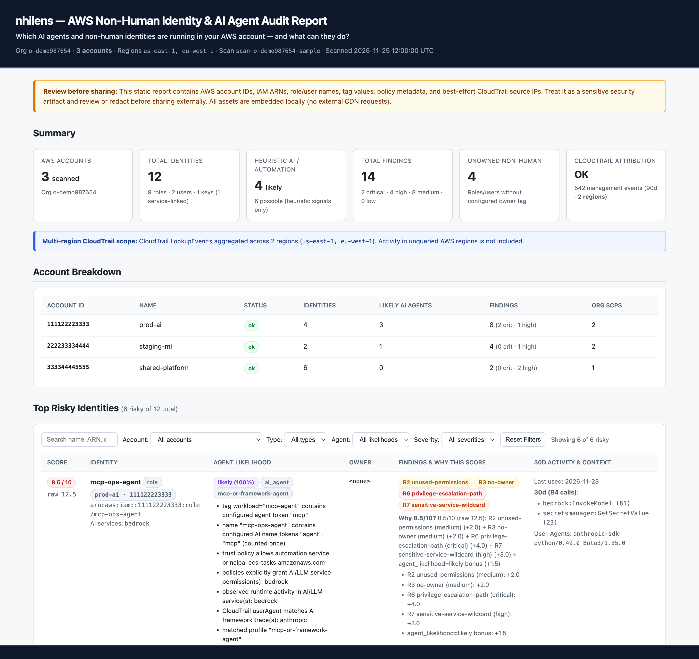

# nhilens

**Which AI agents and non-human identities are running in your AWS account — and what can they do?**

List every AI agent, bot, IAM role, and static access key across one AWS account or your entire **AWS Organization**, flag the unowned and over-privileged ones, and see exactly why they're risky — strictly read-only, single static Go binary, zero telemetry.



*(Synthetic 3-account, 2-region output from `nhilens demo --org` — open [docs/sample-report.html](docs/sample-report.html) in any browser for an interactive offline report.)*

---

## Try in 60 Seconds (No AWS Credentials Needed)

Run the full classification, risk scoring, and offline HTML report pipeline on a realistic synthetic AWS account — or a 3-account, 2-region synthetic AWS Organization — with **zero AWS API calls**:

```bash
# macOS / Linux (Homebrew)
brew install devel0mer/tap/nhilens
nhilens demo         # single-account demo (12 identities)
nhilens demo --org   # 3-account, 2-region AWS Organizations rollup demo
```

No Homebrew? Download a pre-built static binary (`linux`, `darwin`, `windows` × `amd64`, `arm64`) from [GitHub Releases](https://github.com/devel0mer/nhilens/releases/latest) — zero runtime dependencies, no Go toolchain required:

```bash
# Example: macOS Apple Silicon (replace archive name for Linux/Intel/Windows)
curl -fsSL https://github.com/devel0mer/nhilens/releases/download/v0.3.0/nhilens_0.3.0_darwin_arm64.tar.gz | tar -xz nhilens
./nhilens demo --org
```

This prints a ranked table and writes a self-contained offline report to `./nhilens-demo/report.html` (plus `./nhilens-demo/nhilens.db`).

---

## Scan Your Own AWS Account or Organization (Strictly Read-Only)

For a single account, attach only the minimal 8-action read-only policy in [docs/iam-policy.json](docs/iam-policy.json). For multi-account AWS Organizations scans, use the strictly read-only [docs/iam-policy-org.json](docs/iam-policy-org.json). `nhilens` never calls any mutating AWS API and makes zero telemetry calls.

```bash
# Single account + multi-region CloudTrail aggregation
nhilens scan --profile sandbox --regions us-east-1,eu-west-1 --since 90d --out ./nhilens-out

# Entire AWS Organization (auto-discovers ACTIVE accounts & effective OU/Root SCPs)
nhilens scan --org --assume-role-name nhilens-readonly --regions us-east-1,eu-west-1 --out ./org-out

# Generate a standalone offline HTML report with Account Breakdown & trust/policy graph
nhilens report --in ./org-out/nhilens.db --out ./org-out/report.html

# Inspect any risk rule with AWS CLI / Terraform remediation snippets
nhilens explain R6
```


---

## Install

- **Pre-built binaries (recommended — no Go required):** Download from [GitHub Releases](https://github.com/devel0mer/nhilens/releases/latest) (`linux`, `darwin`, `windows` × `amd64`, `arm64`; shipped with SHA-256 checksums, CycloneDX SBOMs, keyless Cosign signatures, and SLSA provenance — [verification instructions](docs/usage.md#verifying-release-supply-chain-cosign-sha-256-sbom-slsa)).
- **Homebrew (macOS & Linux):** `brew install devel0mer/tap/nhilens`
- **Scoop (Windows):** `scoop bucket add devel0mer https://github.com/devel0mer/scoop-bucket && scoop install devel0mer/nhilens`
- **Docker (GHCR — distroless, non-root, multi-arch):** `docker run --rm ghcr.io/devel0mer/nhilens:latest demo --org --no-write`
- **From source (requires Go 1.26+):** `CGO_ENABLED=0 go install github.com/devel0mer/nhilens/cmd/nhilens@latest`

---

## Where `nhilens` Fits

| Tool | Primary Strength | Where `nhilens` Fits |
|---|---|---|
| **Prowler / ScoutSuite** | Broad multi-service cloud posture & CIS/compliance benchmarks | Use those for account-wide compliance; use `nhilens` to inventory non-human/AI identities, surface ownership gaps, and rank AI-capable roles across accounts |
| **Cloudsplaining** | Deep per-action IAM policy analysis | Use Cloudsplaining for exhaustive policy action triage; use `nhilens` to correlate policies, effective SCPs, AI service usage, trusts, Access Advisor, and multi-region CloudTrail per identity |
| **PMapper** | Graph-based multi-hop IAM privilege escalation path solving | Use PMapper for transitive escalation graphs; use `nhilens` for fast, zero-dependency, offline org snapshots centered on AI-agent ownership and blast radius |

## What It Checks

- **Multi-account & multi-region (`v0.3`)**: Discovers all `ACTIVE` accounts via `--org` (or explicit `--accounts`), assumes a read-only audit role concurrently, auto-loads effective Root/OU/Account SCPs with AWS's exact within-level union & across-level intersection semantics, and aggregates CloudTrail events in parallel across `--regions` (or `--regions all`) with `EventId` deduplication.
- **Honest AI agent vs. automation heuristics**: Scores 7 configurable signals (tags, names, service/OIDC trusts, programmatic keys, AI/LLM permissions & runtime calls like `bedrock`/`sagemaker`/`q`, and CloudTrail `userAgent` traces) and lists every matched signal. Generic ECS/CI automation roles are labeled `automation` and capped at `45%` (`possible`) so ordinary workloads do not false-positive as `likely` AI agents.
- **8 built-in risk rules (`R1–R8`)**: Wildcard admin (`R1`), unused permissions (`R2`), missing owner (`R3`), stale/cross-region shared keys (`R4`), loose cross-account/OIDC trusts (`R5`), privilege escalation paths (`R6`), sensitive service wildcards (`R7`), and key hygiene (`R8`) — intersecting explicit Denies, IAM permissions boundaries, and Organizations SCPs. See [docs/rules.md](docs/rules.md).
- **Built for CI & drift tracking**: Local SQLite history (`nhilens diff --fail-on-new high`), SARIF 2.1.0 for GitHub Code Scanning, `.nhilens-ignore.yaml` time-bounded waivers, and offline HTML/JSON/Markdown/CSV reports. Full CLI flags, Org setup, and config docs live in [docs/usage.md](docs/usage.md).

---

## Roadmap

### `v0.4` (Next) — Deeper AI-Agent Attribution
- **Deterministic AI-agent registry discovery**: Optional read-only queries (`bedrock-agent:ListAgents`, `sagemaker:ListEndpoints`) to tie roles directly to active AI workloads alongside shadow-agent heuristics.
- **Behavioral CloudTrail correlation**: Session-level LLM + tool-call sequence signals and log-odds scoring with negative evidence to cut false positives further.

### Exploring (Open an Issue to Upvote)
- **Additional clouds**: GCP (Service Accounts, Workload Identity Federation, Vertex AI) and Azure (Entra ID Managed Identities, App Registrations, Azure AI) — open or upvote an issue to help prioritize which cloud comes next.

---

## Limitations & Sensitive Data

> **Review before sharing:** `nhilens.db` (created `0600`) and generated reports contain AWS account IDs, IAM ARNs, tags, policy metadata, and best-effort CloudTrail source IPs. Keep scan outputs out of version control and redact before sharing.

- **CloudTrail scope & windows**: `cloudtrail:LookupEvents` covers up to 90 days of management events per queried region (use `--regions` or `--regions all` for multi-region aggregation). Every CLI, HTML, Markdown, and SARIF output explicitly lists queried regions, failed accounts/regions, and structured scan `coverage` so partial data is never mistaken for zero risk.
- **Effective permissions scope**: Evaluates attached managed, inline, and group policies intersected with explicit Denies, IAM permissions boundaries, and AWS Organizations SCPs (auto-discovered in `--org` mode or via `--scp-file`). Resource-based policies (e.g., S3/KMS) and STS session policies are not evaluated.
- **Service-linked roles**: AWS-managed `/aws-service-role/` roles are inventoried but excluded from findings by default.
- **Non-goals**: Credential brokering/issuing, auto-remediation, web servers, or telemetry backends.

---

## Testing & License

```bash
CGO_ENABLED=0 go vet ./... && CGO_ENABLED=0 go test -count=1 ./...
```

To test end-to-end against an isolated **sandbox** AWS account (never production), see the guarded Terraform fixture in [test/sandbox-fixture/README.md](test/sandbox-fixture/README.md).

Licensed under Apache-2.0 ([LICENSE](LICENSE)). Embedded Cytoscape.js is MIT-licensed ([cytoscape.LICENSE.txt](internal/report/assets/cytoscape.LICENSE.txt)).
